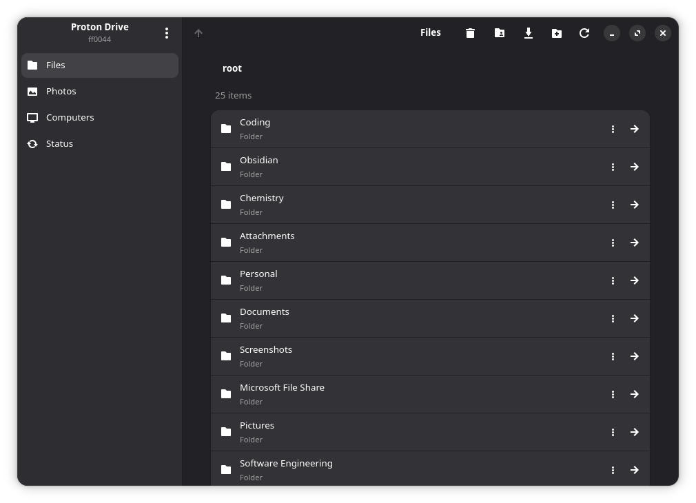
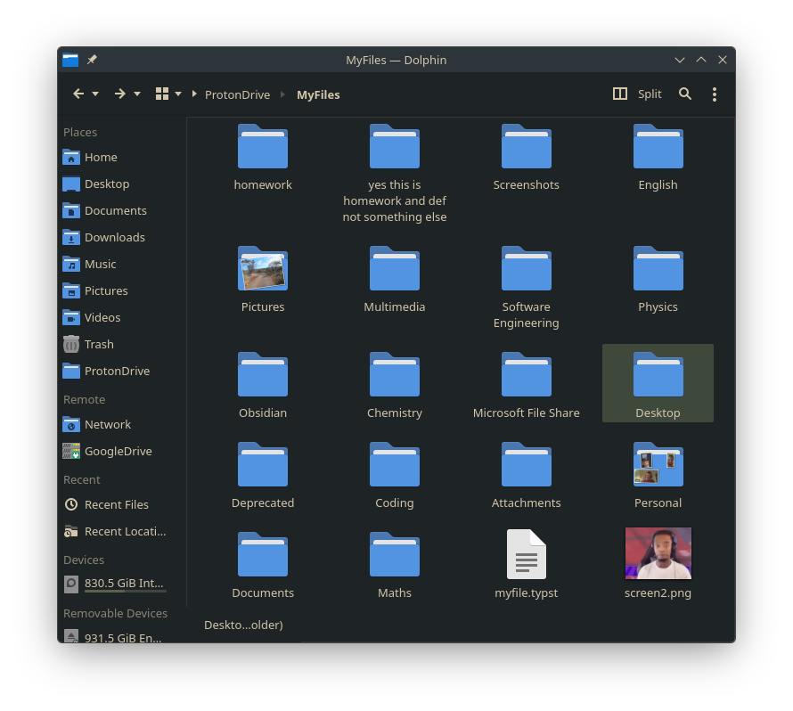

# proton-sdk-rs2

An unofficial Rust port of the Proton Drive SDK, plus **pdcli**, a GTK4 and FUSE Proton Drive client for Linux.





> This is community software, not a Proton product. It can change files in your
> Drive. Keep an independent backup of anything important, and always remember the 3-2-1 backup rule. 

## pdcli

pdcli mounts your Drive at `~/ProtonDrive` with FUSE, syncs changes in the
background, and comes with a GTK desktop app and tray icon. It also handles
Photos, Computer backups, sharing, trash, version history and full account
exports from the command line.

```sh
pdcli login
pdcli mount
ls ~/ProtonDrive/MyFiles
```

See the [pdcli README](crates/pdcli/README.md) for features and commands.

## Crates

| Crate | Purpose |
| --- | --- |
| [`proton-sdk-rs2`](crates/proton-sdk-rs2) | Authentication, sessions and account APIs |
| [`proton-drive-sdk`](crates/proton-drive-sdk) | Drive, Photos, sharing, transfers and encrypted caching |
| [`pdcli`](crates/pdcli) | The command-line client, desktop app and FUSE mount |

## Install

Release builds and `.deb` packages are on the
[releases page](https://github.com/tirbofish/proton-sdk-rs2/releases). Recipes
for Debian, Fedora and Arch packages are in
[`packaging/README.md`](packaging/README.md).

### From source

Install the build dependencies:

```sh
# Debian / Ubuntu
sudo apt install build-essential cargo rustc pkg-config protobuf-compiler \
  libdbus-1-dev libgtk-3-dev libgtk-4-dev libadwaita-1-dev libxdo-dev \
  libayatana-appindicator3-dev libfuse3-dev

# Arch Linux
sudo pacman -S --needed base-devel rust protobuf pkgconf gtk3 gtk4 libadwaita \
  libxdo libayatana-appindicator fuse3
```

Then build and install both `pdcli` and `pdcli-gui`:

```sh
git clone https://github.com/tirbofish/proton-sdk-rs2
cd proton-sdk-rs2
cargo install --locked --path crates/pdcli
```

## License

MIT. See [`LICENSE.md`](LICENSE.md).
