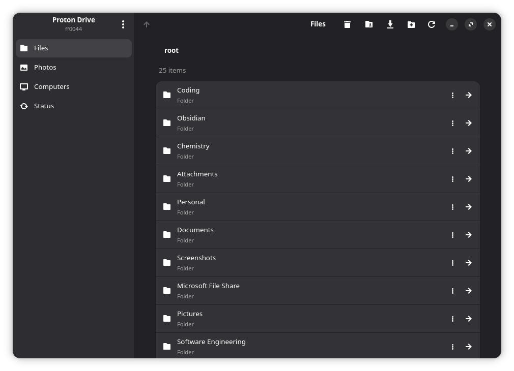
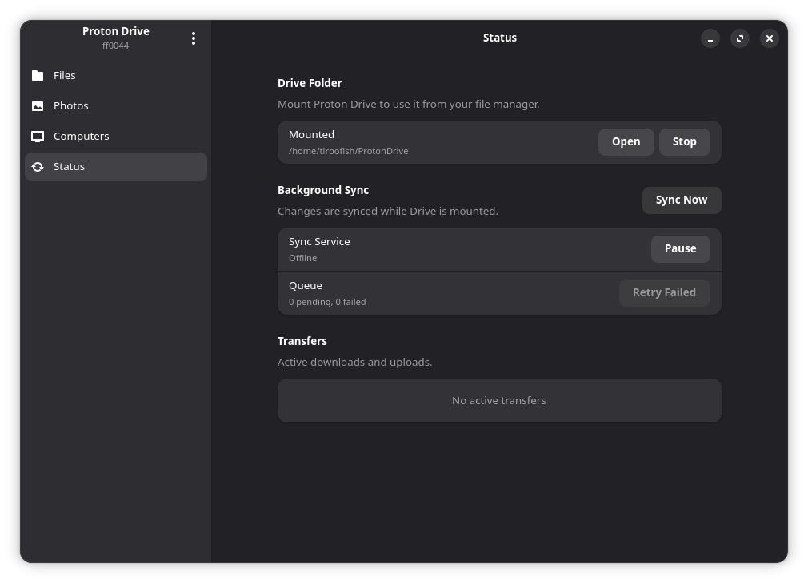
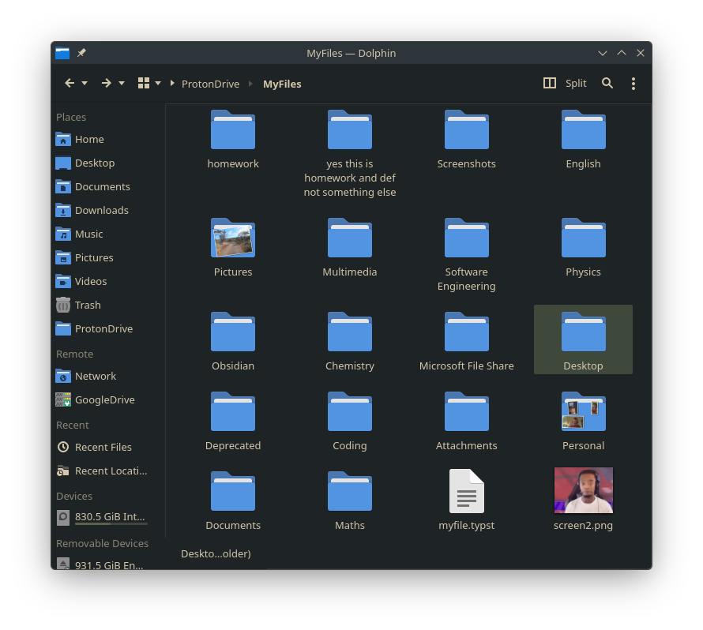

# pdcli
Proton Drive Command Line Interface (an older name) is an unofficial Proton Drive sync client, and both a command line interface (CLI) + a graphical user interface running under GTK4. 

pdcli is powered by the [proton-sdk-rs2](https://crates.io/crates/proton-sdk-rs2) rust port of the [ProtonDriveApps/sdk](https://github.com/ProtonDriveApps/sdk). 

<p>
  
  
  
</p>

> pdcli is community software, not a Proton product. Keep an independent
> backup of important data. 

## Features

- **Drive in your file manager.** Files download when you open them, and large
  files stream instead of downloading in full. Changes upload in the background.
- **Offline files.** Keep chosen files or folders on the device, and free up the
  space when you no longer need them.
- **Desktop app and tray.** Browse and share files, view Photos and albums,
  manage backups, and watch transfer progress with speed and time left.
- **Computer backups.** Back up local folders to Computers, or restore one to a
  new machine.
- **Photos.** Import folders without uploading duplicates, find and remove
  duplicates, mark favorites, create albums and export the library.
- **Sharing.** Public links with roles, passwords and expiry; invitations;
  shared with me and shared by me lists.
- **Trash and versions.** Restore or delete trashed items, and restore,
  download or delete earlier versions of a file.
- **Proton Docs.** Export documents as Markdown and open Docs and Sheets
  shortcuts from the mount in the browser.
- **Takeout.** Export My Files, Photos and Computer backups to a local folder.
  Rerunning resumes where it stopped.

## Install

Install `pdcli` through crates.io or through GitHub releases (if it's released).

```bash
cargo install pdcli
```

This also installs the gui, and can be launched through
```bash
pdcli
```

## Usage

To find all commands available, start off with
```bash
pdcli --help
# or just start with login
pdcli login
```

Enable it at startup as well:
```sh
pdcli service enable                          # source installs
systemctl --user enable --now pdcli.service   # distribution packages
```